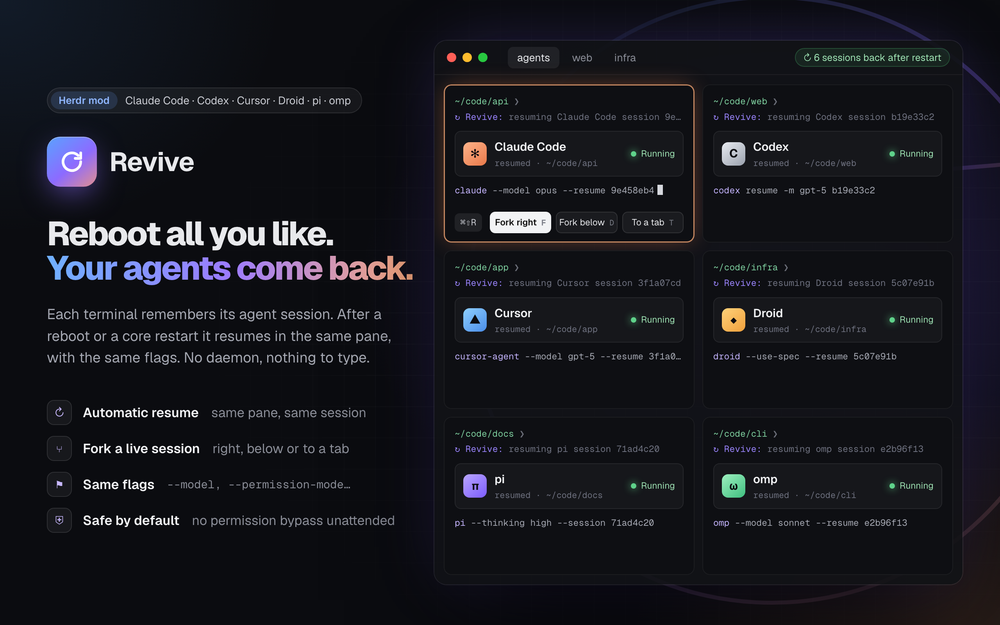

# ↻ Revive

[](https://github.com/dmazlum/herdr-revive/actions/workflows/ci.yml)

Bring back the coding agent a [Herdr](https://herdr.dev) terminal lost, and fork a live
session beside it.

Herdr keeps your terminals through app restarts and updates. When the machine reboots or
herdr-core stops, each pane comes back with a fresh shell in the same folder, but the agent
that was running there is gone. Revive remembers which session each terminal held and,
when its shell comes back, starts that session again in the same pane, with the same
flags.



## Requirements

- The **Herdr desktop app 0.1.9+**
- **Node 20+**
- **zsh** or **bash** (other shells: see [Limits](#limits))
- At least one supported agent:

| Agent | Status | Resumes with | Forks with | Recorded by |
| --- | --- | --- | --- | --- |
| Claude Code | supported | `claude --resume <id>` | `claude --resume <id> --fork-session` | hooks |
| Codex | experimental | `codex resume <id>` | `codex fork <id>` | hooks |
| [pi](https://pi.dev) | experimental, community-maintained (tested with pi 1.4; pi issues: ping @llehouerou) | `pi --session <id>` | `pi --fork <id>` | extension |
| [oh-my-pi](https://github.com/can1357/oh-my-pi) (`omp`) | experimental (tested with omp 18.16) | `omp --resume <id>` | `omp --fork <id>` | extension |
| [Factory Droid](https://docs.factory.com) (`droid`) | experimental | `droid --resume <id>` | `droid --fork <id>` | hooks |
| [Cursor CLI](https://cursor.com/docs/cli/overview) (`cursor-agent`) | experimental | `cursor-agent --resume <id>` | no fork | hooks |

What "experimental" means for each one is under [Limits](#limits).

## Features

- **Automatic resume.** After a reboot or a core restart, the pane's new shell resumes the
  session in its folder, before you touch anything. A dim line says what it is doing.
- **Only what was lost.** A session you ended yourself (`/exit`, Ctrl+C, `/logout`; pi's
  `/quit`) is forgotten on the spot. A session that was never sent a message is skipped,
  since it has nothing to resume. A shell you start inside a pane never resumes anything.
- **Same flags.** The model, permission and sandbox modes come back with the session; see
  [What comes back](#what-comes-back) for what doesn't.
- **Fork.** Open the conversation of the focused agent as a new session beside it (right,
  below or in a new tab), with the same flags. Both work in the same folder: a fork copies
  the conversation, not the files.
- **Resume by hand.** An agent that died under a shell that survived it (a crash, a `kill`)
  is listed as *Interrupted*, with a **Resume** button. One whose resume failed is listed
  as *Resume failed*, with a retry.
- **Per terminal.** Turn automatic resume off for one terminal in the dialog, or for a
  whole shell with `REVIVE_AUTO=0`.
- **Nothing to run.** No background process. Sessions are remembered as labels on their
  herdr-core terminals, so the record lives exactly as long as the terminal does.

## What comes back

A resumed session runs unattended after a reboot, and its record is kept in terminal
labels, which any program that can talk to herdr-core can change. So Revive brings back
only what is needed to continue the conversation, and filters the record again when it
reads it back, not only when it writes it.

**Carried.** `--model` and similar flags, and permission and sandbox modes, so the session
comes back the way it ran: Claude Code's `--permission-mode` and
`--dangerously-skip-permissions`, Codex's approval and sandbox flags, Droid's `--auto`,
Cursor's `--force`/`--yolo` and `--sandbox`, omp's `--auto-approve` and `--approval-mode`.
The agent still waits for your input before it does anything.

**Left behind.**
- The first prompt, `--resume` itself, and secrets (`--api-key`, `-H`).
- Anything that makes the agent load code, configuration or instructions it wouldn't load
  otherwise:
  - settings, hooks, extensions, plugins or MCP servers: `--settings`, `--mcp-config`,
    `--plugin-dir`, `-e`/`--extension`, `--hook`, `--config`, `--approve-mcps`
  - extra instructions: `--system-prompt`, `--append-system-prompt`, `--skill`
  - extra folders: `--add-dir`, omp's `--allow-home`, Cursor's `--workspace`

  A session started with one of these comes back without it.

**Config folders.** The folder an agent loads its settings or sessions from is never taken
from the record. For a session started under another config folder (`CLAUDE_CONFIG_DIR`,
`CODEX_HOME`, `PI_CODING_AGENT_DIR`, …), Revive records only the variable's name, and
resumes the session by itself only when the new shell sets that variable on its own (in
your rc file, say). A session started with pi's or omp's `--session-dir` never resumes by
itself. In both cases the shell prints a dim line once, and the dialog shows the command to
run in a shell that has what's missing, with a **Copy command** button. It doesn't type
the command itself, and offers no Resume or Fork for that session.

**Working folder.** The session's folder is used by its real path, and only when it exists,
is yours and is not writable by everyone. Otherwise the session is not resumed at all, not
even by hand, since the agent would start in another folder with its flags. The dialog says
which folder failed.

## Install

In Herdr, ask your agent to add `github.com/dmazlum/herdr-revive`: it reads
[`RECIPE.md`](RECIPE.md) and every file, copies `mods/revive`, merges
[`keys.json`](keys.json), checks the mod and runs the install step. Or by hand:

```sh
git clone https://github.com/dmazlum/herdr-revive
cp -R herdr-revive/mods/revive ~/.config/herdr-app/mods/
herdr-app check ~/.config/herdr-app/mods/revive
node ~/.config/herdr-app/mods/revive/revive.mjs install
```

Then merge [`keys.json`](keys.json) into `~/.config/herdr-app/keys.json`:

| Key | What it does |
| --- | --- |
| `cmd-shift-r` → `mod.open:revive` | Open the dialog for the focused terminal |
| `F` / `D` / `T` in the dialog | Fork the focused agent right / below / to a new tab |
| `↵` in the dialog | Resume the focused terminal's session |
| `R` | Refresh |
| Esc | Close |

### What `install` changes

Each agent is set up only when it looks installed:

- Claude Code, Codex, pi and omp: their folder exists (`~/.claude`, `~/.codex`,
  `~/.pi/agent`, `~/.omp/agent`, or the folder `CLAUDE_CONFIG_DIR`, `CODEX_HOME` or
  `PI_CODING_AGENT_DIR` names).
- Droid: `~/.factory` exists and the `droid` CLI is on `PATH` or in `~/.local/bin`.
- Cursor: the `cursor-agent` CLI is on `PATH` or in `~/.local/bin`, or
  `~/.local/share/cursor-agent` exists.

| Agent | What it adds |
| --- | --- |
| Claude Code | `SessionStart` and `SessionEnd` hooks in `~/.claude/settings.json`. The hook names the engine as `"$HOME/…"` when it is under your home folder, so a `settings.json` synced between machines finds it on each. |
| Codex | The same two hooks in `~/.codex/hooks.json`. Codex asks you to trust them the next time it starts. |
| pi | A link from `~/.pi/agent/extensions/herdr-revive.ts` to `mods/revive/pi/revive.ts`. pi loads it the next time it starts, or at `/reload`. |
| omp | A link from `~/.omp/agent/extensions/herdr-revive.ts` to `mods/revive/omp/revive.ts`. omp loads it the next time it starts. |
| Droid | The two hooks in `~/.factory/hooks.json` if you have one, else in the `hooks` key of `~/.factory/settings.json` (Droid reads that one only while there is no `hooks.json`). Droid warns that its hooks changed and shows them in `/hooks`. |
| Cursor | `sessionStart` and `sessionEnd` in `~/.cursor/hooks.json`. A `~/.cursor` folder alone doesn't count as installed, since the Cursor editor makes one and reads that `hooks.json` too. |

Droid's and Cursor's hooks run `revive.mjs hook --agent droid|cursor`.

It also adds a short block to the file your shell reads at start:

- **zsh:** `~/.zshrc`. zsh is asked where it is, so a `ZDOTDIR` set in `~/.zshenv` is
  followed.
- **bash on macOS:** the first of `~/.bash_profile`, `~/.bash_login` and `~/.profile` that
  exists. herdr-core starts terminals there as login shells, which don't read `~/.bashrc`.
- **bash on Linux:** `~/.bashrc`, since herdr-core starts bash there without `-l`
  ([herdr-core#99](https://github.com/herdrdev/herdr-core/issues/99)). Only one bash file
  keeps the block: one an earlier version put in a login file is taken out.

How it treats your files:

- A symlinked file (a dotfiles repository) is changed where the link points, and every
  file keeps its permissions.
- The first time it changes a file, the original is copied to `<file>.revive-backup`;
  later runs keep that copy.
- If an agent's file isn't valid JSON, that agent is skipped with a note, the file is left
  as it is, and the rest is installed.
- An extension already at pi's or omp's path (a copy your package manager placed, say) is
  left as it is, and `uninstall` takes out only the link `install` made.
- Running it again changes nothing, so it is also how you bring the hooks and the shell
  block up to date after updating Revive. The **Install** button in the dialog does the
  same.

```sh
node ~/.config/herdr-app/mods/revive/revive.mjs install --zsh --bash   # both shells
node ~/.config/herdr-app/mods/revive/revive.mjs install --no-pi        # skip an agent: --no-codex, --no-pi, --no-omp, --no-droid, --no-cursor
node ~/.config/herdr-app/mods/revive/revive.mjs uninstall              # take it all out
node ~/.config/herdr-app/mods/revive/revive.mjs doctor                 # what is installed
```

## Updates

Herdr updates its own mods, not ones you added: yours is a copy, and nothing tells you
when this repo changes. To hear about a new version, watch the repo for releases (on
GitHub: **Watch → Custom → Releases**). Each
[release](https://github.com/dmazlum/herdr-revive/releases) says what changed and whether
`keys.json` did; merge it again when it did.

The version you have is `"version"` in `~/.config/herdr-app/mods/revive/mod.json`. To
update, ask your agent to replace that folder with the latest `mods/revive` from
`github.com/dmazlum/herdr-revive`. Adding it again isn't enough: an agent never
overwrites a mod, it would add a second copy under a new name. If the mod was renamed when
it was added (a name clash), the renamed folder is the one to replace, renamed the same way.
Or by hand:

```sh
git -C herdr-revive pull          # or clone it again
rm -rf ~/.config/herdr-app/mods/revive
cp -R herdr-revive/mods/revive ~/.config/herdr-app/mods/
herdr-app check ~/.config/herdr-app/mods/revive
node ~/.config/herdr-app/mods/revive/revive.mjs install
```

Run `install` after every update: it brings the hooks and the shell block up to date and
changes nothing when they already are.

## How it works

1. **Record.** When an agent starts a session in a Herdr terminal, its `SessionStart` hook
   runs `revive.mjs hook`. pi and omp have no hooks file: Revive's extension for each runs
   it with the same payload. The session id is the hook's `session_id` (Claude Code,
   Codex, Droid, pi, omp) or `conversation_id` (Cursor, whose folder comes from
   `workspace_roots`). The hook labels the terminal (`hc label`) with the agent, the
   session id, the folder, the flags worth keeping, and the pid and start time of the
   terminal's program. Only the agent in the terminal's foreground is recorded (with any
   wrapper that launches it): a `claude -p` it runs as a tool is not.
2. **Forget or keep.** When the session ends, `SessionEnd` tells why. You ended it: the
   labels go. A signal ended it (reason `other`): the labels stay. `/clear` leaves them to
   the new session, which records itself. Droid sends Claude Code's reasons. Cursor's
   `completed` and `user_close` forget the session; anything else (`aborted`, `error`, …)
   keeps it.
3. **Resume.** After a reboot or a core restart, herdr-core gives the terminal a new shell.
   Its rc file checks, without starting anything, that a session is remembered and that it
   is the terminal's own shell, then asks `revive.mjs check`. A terminal whose program is
   no longer the remembered one (by pid and start time, since pids start over after a
   reboot) lost its agent, so `check` prints the commands that resume the session. The
   shell runs them at its first prompt, once its rc files are done, and hands the agent
   the terminal device itself, so prompt themes that hold the shell's output while it
   starts (an instant prompt) don't get in the way.
4. **Fail once.** If the agent exits with an error within 15 seconds, the terminal is
   marked as failed and the dialog offers a retry. A failed session is not tried again
   automatically.

To look inside:

```sh
hc get t3 --json | jq '.labels | with_entries(select(.key | startswith("revive.")))'
hc label t3 revive.auto=off      # no automatic resume for t3
REVIVE_DEBUG=1 zsh               # say why a shell did or didn't resume
```

## Limits

### General

- Local only. Terminals on another machine are not remembered yet.
- Sessions started before Revive was installed have no record. The dialog still finds a
  running one from the files its agent writes (Claude Code: `sessions/<pid>.json`; Droid:
  the newest `~/.factory/sessions/<folder, dashed>/<id>.jsonl` written since it started;
  Cursor: the newest `~/.cursor/chats/<md5 of the folder>/<id>/`), so it can be forked, but
  it won't come back by itself.
- An agent that died while its shell lived on is not resumed automatically, since nothing
  told the shell. Use **Resume** in the dialog.
- Shells: zsh and bash. Other shells can run `revive.mjs check --shell $$` from their own
  rc file and evaluate what it prints.

### Codex

Its hooks follow the same format as Claude Code's, and Codex behind a wrapper (npm's
`node …/bin/codex`, a launcher script) is recognized, but Revive can't check whether a
Codex session can be resumed before trying. Codex 0.163.0 also runs its sessions in a
shared background daemon, which Revive was not built for:

- `SessionEnd` always reports reason `other`, so Revive can't tell a session you ended from
  one a crash or a restart ended. A session you left with `/quit` stays remembered, shows
  as *Interrupted*, and comes back at the next restart. To stop that, turn automatic resume
  off for that terminal in the dialog.
- `/quit` sends no `SessionEnd`. When the daemon stops (its pane closes), it sends one for
  every session it held.
- The daemon, not the terminal's Codex process, runs the hooks, so they can't tell which
  terminal a session is in, and a session it runs is not recorded. The dialog still shows
  the running Codex, without Fork. To have Codex sessions recorded, run Codex without the
  daemon: `daemon_auto_start = false` under `[features]` in `~/.codex/config.toml`. Codex
  warns that this can turn off features for other apps that share the daemon.
- Codex fires `SessionStart` at a session's first message, so a session is recorded only
  from then.

### pi and omp

Both are recorded through Revive's extension, only for an interactive session in a Herdr
terminal (not `-p`, `--mode json|rpc` (omp also `rpc-ui`), `--no-session`, omp's
`--export`, or the subagents they start). The two extensions share their engine code
(`mods/revive/lib/extension.js`).

- Both rename their process (`pi`, `omp`), so `ps` and Herdr no longer see their flags; the
  extension sends the command line with the hook.
- Both keep sessions where their flags, environment or settings say, so the record names
  the session file, and the transcript check looks only at that file.
- A pi or omp started before the extension was installed is not recorded (for pi: or
  before `/reload`).

**pi** is community-maintained, tested with pi 1.4.0; a new pi release may change its
flags, `--session`/`--fork` or how it ends on a signal.

- pi reports `quit` for every end, `/quit` and a reboot alike. The extension tells them
  apart by listening for the SIGTERM and SIGHUP a reboot, a core restart or a `kill`
  sends: a session a signal ended stays remembered; one you quit is forgotten.

**omp** is tested with omp 18.16.0 on Linux.

- omp's `session_shutdown` carries no reason. The extension tells a reboot, core restart
  or `kill` (SIGTERM, SIGHUP: kept) from `/exit`, Ctrl+C or Ctrl+D (forgotten).
- `/new`, `/resume` and `/fork` inside omp report `session_switch`; the new session is
  recorded in place of the old one.
- omp also reads `PI_CODING_AGENT_DIR`. Revive assumes that variable belongs to pi and
  links omp's extension into omp's default folder (`~/.omp/agent/extensions`). Named
  profiles (`--profile`) have their own extension folder and are not installed into.

### Droid and Cursor

- Droid (1.1.0) and the Cursor CLI (2026.10.22) were checked by hand: the hooks record the
  session and flags, and resume (and Droid's fork) reopen the conversation. Not checked
  yet: a real reboot with either. Like Codex, neither is checked for a resumable session
  before trying: a failed resume is marked *Resume failed*.
- Cursor sends `completed` for `/exit` and Ctrl+C twice (forgotten), `aborted` when it is
  killed with SIGTERM (kept), and no `sessionEnd` at all when its terminal closes (kept).
- Cursor installs as `cursor-agent` and `agent`. `agent` is a common name, so it counts as
  Cursor only under a path that says so (`…/cursor-agent/…`) or when it reports itself as
  Cursor to Herdr. Cursor's hooks also run for the Cursor editor's chats; outside a Herdr
  terminal they do nothing.

## Development

```sh
npm test    # labels, states, flags, quoting, the resume script, install and uninstall
```

The UI is checked in Herdr: `herdr-app check`, then `herdr-app shot` while the dialog is
open. To test a real restart without touching your own terminals, start a second
herdr-core with its own `HC_SESSION` and `XDG_STATE_HOME`/`XDG_RUNTIME_DIR` (a short path:
socket paths are limited to about 100 bytes) and restart that one.

While developing, copy the folder again after each change; Herdr reloads the mod within
a second. Copy, don't symlink: Herdr doesn't reload a symlinked mod folder when its files
change.

```sh
cp -R herdr-revive/mods/revive ~/.config/herdr-app/mods/
```

## License

MIT
