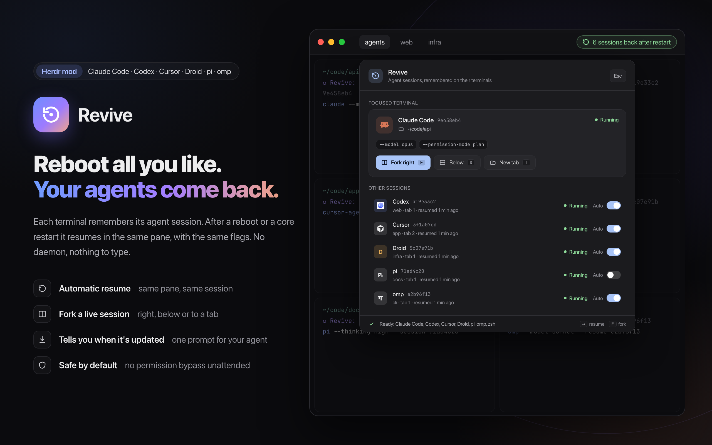

# ↻ Revive

[](https://github.com/dmazlum/herdr-revive/actions/workflows/ci.yml)

**Reboot all you like. Your agents come back.**

It's late and you have six agents going. Claude Code is halfway through the API refactor,
Codex is on the frontend, Droid is in infra. Then the machine restarts for an update.
[Herdr](https://herdr.dev) brings every pane back in the right folder, but each one now
holds an empty shell. You're left scrolling `--resume` pickers, trying to work out which
conversation lived where.

With Revive, you open the lid and they're already back. Each terminal remembers its agent
session. When the shell returns, the session returns with it: the same pane, the same
conversation, the same model and flags. There's nothing to type and nothing running in the
background. While an agent is live, one key forks its conversation into a new pane beside
it.

Works with **Claude Code**, **Codex**, **Copilot CLI**, **Cursor**, **Droid**, **Antigravity CLI**, **Muse**, **pi** and **omp**.



> **Doesn't Herdr do this already?** The original `herdr` restores agent panes itself. The
> Herdr desktop app and herdr-core don't yet: they will once agents can report how to resume
> through OSC 7501 ([herdr-core#13](https://github.com/herdrdev/herdr-core/issues/13)).
> Until then, Revive fills the gap.

## Requirements

- The **Herdr desktop app 0.1.9+**
- **Node 20+**
- **zsh** or **bash**; on Windows, **PowerShell 7** (`pwsh`) or **Windows PowerShell 5.1**
  (other shells: see [Limits](#limits))
- At least one supported agent:

| Agent | Status | Resumes with | Forks with | Recorded by |
| --- | --- | --- | --- | --- |
| Claude Code | supported | `claude --resume <id>` | `claude --resume <id> --fork-session` | hooks |
| Codex | experimental | `codex resume <id>` | `codex fork <id>` | hooks |
| [pi](https://pi.dev) | experimental, community-maintained (tested with pi 1.4; pi issues: ping @llehouerou) | `pi --session <id>` | `pi --fork <id>` | extension |
| [oh-my-pi](https://github.com/can1357/oh-my-pi) (`omp`) | experimental (tested with omp 18.16) | `omp --resume <id>` | `omp --fork <id>` | extension |
| [Factory Droid](https://docs.factory.com) (`droid`) | experimental | `droid --resume <id>` | `droid --fork <id>` | hooks |
| [Cursor CLI](https://cursor.com/docs/cli/overview) (`cursor-agent`) | experimental | `cursor-agent --resume <id>` | no fork | hooks |
| [GitHub Copilot CLI](https://github.com/github/copilot-cli) (`copilot`) | experimental (tested with copilot 1.0.109 and 1.0.111) | `copilot --resume <id>` | no fork (use `/fork` inside) | hooks |
| Antigravity CLI (`agy`) | experimental (tested with agy 1.5.13 on Windows) | `agy --conversation <id>` | no fork | hooks |
| Muse (`muse`) | experimental (tested with muse 1.4.24 on macOS; not on Windows) | `muse resume <id>` | no fork | plugin |

What "experimental" means for each one is under [Limits](#limits).

## Features

- **Automatic resume.** After a reboot or a core restart, the pane's new shell resumes the
  session in its folder, before you touch anything. A dim line says what it is doing.
- **Only what was lost.** A session you ended yourself (`/exit`, Ctrl+C, `/logout`; pi's
  `/quit`) is forgotten on the spot. A session that was never sent a message is skipped,
  since it has nothing to resume. A shell you start inside a pane never resumes anything.
- **Same flags.** The model, permission and sandbox modes come back with the session; see
  [What comes back](#what-comes-back) for what doesn't.
- **Safe by default.** An automatic resume never brings back a flag that lifts approvals or
  the sandbox (`--dangerously-skip-permissions`, `--yolo`, `--force`, …), and its dim line
  says which it left out. Those come back only when you resume from the dialog.
- **Fork.** Open the conversation of the focused agent as a new session beside it (right,
  below or in a new tab), with the same flags. Both work in the same folder: a fork copies
  the conversation, not the files.
- **Resume by hand.** An agent that died under a shell that survived it (a crash, a `kill`)
  is listed as *Interrupted*, with a **Resume** button. One whose resume failed is listed
  as *Resume failed*, with a retry.
- **Already running.** A Claude Code session started before Revive was installed can be
  remembered with **Remember** in the dialog, or all at once with `revive.mjs adopt` (see
  [Limits](#limits)).
- **Per terminal.** Turn automatic resume off for one terminal in the dialog, or for a
  whole shell with `REVIVE_AUTO=0`.
- **Pick up the work (omp, opt-in).** Turn on **Continue** for an omp terminal, and its
  session comes back with `omp --restore` instead of `--resume`: omp goes on with the turn
  and the subagents it left unfinished (see [pi and omp](#pi-and-omp)).
- **Nothing to run.** No background process. Sessions are remembered as labels on their
  herdr-core terminals, so the record lives exactly as long as the terminal does.

## What comes back

A resumed session runs unattended after a reboot, and its record is kept in terminal
labels, which any program that can talk to herdr-core can change. So Revive brings back
only what is needed to continue the conversation, and filters the record again when it
reads it back, not only when it writes it.

**Carried.** `--model` and similar flags, and permission and sandbox modes, so the session
comes back the way it ran (`--permission-mode plan`, Codex's `-s workspace-write`, …). The
agent still waits for your input before it does anything.

**Only when you resume it yourself.** Flags that lift approvals or the sandbox come back
only in a resume you start from the dialog:

| Agent | Left out of an automatic resume |
| --- | --- |
| Claude Code | `--dangerously-skip-permissions`, `--allow-dangerously-skip-permissions`, `--permission-mode` other than `default`, `manual`, `plan` or `dontAsk` |
| Codex | `--dangerously-bypass-approvals-and-sandbox`, `--yolo`, `--approve-for-me`, `-a never`, `-s danger-full-access` |
| Cursor | `-f`/`--force`, `--yolo`, `--sandbox` other than `enabled` |
| Copilot CLI | `--allow-all`/`--yolo`, `--allow-all-tools`, `--allow-all-paths`, `--allow-all-urls`, `--allow-tool`, `--allow-url` |
| Antigravity CLI | `--dangerously-skip-permissions`, `--mode` other than `plan` |
| omp | `--auto-approve`, `--plan-yolo`, `--approval-mode` |
| Droid | `--auto` |
| Muse | `--approval-mode` other than `untrusted` or `on-request` |
| pi | `-a`/`--approve` |

A label can be written by any program that talks to herdr-core, including an agent running
under restricted permissions. A bypass it slipped into a record must not come back
unrestricted after a reboot, with nobody watching. So the resumed pane says what it left
out:

```
↻ Revive  resuming Claude Code session 9e458eb4 · REVIVE_AUTO=0 skips this
  without --dangerously-skip-permissions (only a resume from the Revive dialog keeps it)
```

The original flags stay remembered for a later manual resume from the dialog.
Exiting the agent normally still forgets its session.

**Names, not paths.** Flags that pick something by name are carried only with a plain name:
Codex's and omp's `--profile`, Claude Code's `--agent` (`reviewer`, `my-plugin:reviewer`)
and omp's `--skills` (`commit,review`). A value that looks like a path is dropped.

**Left behind.**
- The first prompt, `--resume` itself, and secrets (`--api-key`, `-H`).
- Anything that makes the agent load code, configuration or instructions it wouldn't load
  otherwise:
  - settings, hooks, extensions, plugins or MCP servers: `--settings`, `--mcp-config`,
    `--plugin-dir`, `-e`/`--extension`, `--hook`, `--config`, `--approve-mcps`
  - extra instructions: `--system-prompt`, `--append-system-prompt`, `--skill`
  - extra folders: `--add-dir`, omp's `--allow-home`, Cursor's `--workspace`
  - Copilot CLI's `--additional-mcp-config`, `--enable-mcp-server`, `--plugin-dir` and
    `--share…`

  A session started with one of these comes back without it.

**Config folders.** The folder an agent loads its settings or sessions from is never taken
from the record. For a session started under another config folder (`CLAUDE_CONFIG_DIR`,
`CODEX_HOME`, `PI_CODING_AGENT_DIR`, …), Revive records only the variable's name, and
resumes the session by itself only when the new shell sets that variable on its own (in
your rc file, say). Claude Code's Code Mode (`CLAUDE_CODE_EXPERIMENTAL_CODE_MODE=1`) is
kept the same way, since a session started in it can be resumed only with Code Mode on;
turned on in `~/.claude/settings.json` instead of the shell, it gets the command to run
rather than coming back by itself. A session started with pi's or omp's `--session-dir`
never resumes by itself. In both cases the shell prints a dim line once, and the dialog shows the command to
run in a shell that has what's missing, with a **Copy command** button. It doesn't type
the command itself, and offers no Resume or Fork for that session.

**Working folder.** The session's folder is used by its real path, and only when it exists,
is yours, and nobody else can write to it: not everyone, and not its group, unless that
group is your own private one (as with a Linux umask of 002). Otherwise the session is not
resumed at all, not even by hand, since the agent would start in another folder with its
flags. The dialog says which folder failed.

On Windows, file modes say nothing, so the folder's ACL decides: its owner must be you, the
Administrators group or SYSTEM, and neither Everyone nor Anonymous Logon may write to it.
Other users' write access is not refused, since Windows gives Authenticated Users Modify on
every folder made outside your profile (`C:\code`, `D:\work`), where most code lives. This is
looser than "nobody else can write to it" on macOS and Linux: on a machine other people sign
in to, they could change the files in such a folder, and a resumed agent would start there.
If that matters, keep your projects under your profile, or take away Authenticated Users'
write access to the folder.

## Install

In Herdr, ask your agent to add `github.com/dmazlum/herdr-revive`: it reads
[`RECIPE.md`](RECIPE.md) and every file, copies `mods/revive`, merges
[`keys.json`](keys.json), checks the mod and runs the install step. Or by hand:

```sh
git clone https://github.com/dmazlum/herdr-revive
cp -R herdr-revive/mods/revive ~/.config/herdr-app/mods/
herdr-app check ~/.config/herdr-app/mods/revive
node ~/.config/herdr-app/mods/revive/revive.mjs install
```

On Windows, in PowerShell:

```powershell
git clone https://github.com/dmazlum/herdr-revive
Copy-Item -Recurse herdr-revive\mods\revive ~\.config\herdr-app\mods\
herdr-app check ~\.config\herdr-app\mods\revive
node ~\.config\herdr-app\mods\revive\revive.mjs install
```

Then merge [`keys.json`](keys.json) into `~/.config/herdr-app/keys.json`:

| Key | What it does |
| --- | --- |
| `cmd-shift-r` → `mod.open:revive` | Open the dialog for the focused terminal |
| `F` / `D` / `T` in the dialog | Fork the focused agent right / below / to a new tab |
| `↵` in the dialog | Resume the focused terminal's session |
| `R` | Refresh |
| Esc | Close |

On Windows and Linux there is no `cmd` key. To open the dialog from the keyboard there, add
`"ctrl-shift-r": "mod.open:revive"` under `"global"` yourself. It isn't in `keys.json`
because a global binding takes the key from every program running in a terminal.

### What `install` changes

Each agent is set up only when it looks installed:

- Claude Code, Codex, pi and omp: their folder exists (`~/.claude`, `~/.codex`,
  `~/.pi/agent`, `~/.omp/agent`, or the folder `CLAUDE_CONFIG_DIR`, `CODEX_HOME` or
  `PI_CODING_AGENT_DIR` names).
- Droid: `~/.factory` exists and the `droid` CLI is on `PATH` or in `~/.local/bin`.
- Cursor: the `cursor-agent` CLI is on `PATH` or in `~/.local/bin`, or
  `~/.local/share/cursor-agent` exists.
- Copilot CLI: `~/.copilot` (or `COPILOT_HOME`) exists and the `copilot` CLI is on `PATH`,
  in `~/.local/bin`, `/opt/homebrew/bin` or `/usr/local/bin`.
- Antigravity CLI: the `agy` CLI is on `PATH`, in `~/.local/bin`, or (on Windows) in
  `~\AppData\Local\agy\bin`.

| Agent | What it adds |
| --- | --- |
| Claude Code | `SessionStart` and `SessionEnd` hooks in `~/.claude/settings.json`. The hook names the engine as `"$HOME/…"` when it is under your home folder, so a `settings.json` synced between machines finds it on each. |
| Codex | The same two hooks in `~/.codex/hooks.json`. Codex asks you to trust them the next time it starts. |
| pi | A link from `~/.pi/agent/extensions/herdr-revive.ts` to `mods/revive/pi/revive.ts`. pi loads it the next time it starts, or at `/reload`. On Windows, where a link needs administrator rights, a two-line file that loads `mods/revive/pi/revive.ts` instead. |
| omp | A link from `~/.omp/agent/extensions/herdr-revive.ts` to `mods/revive/omp/revive.ts` (on Windows, the same two-line file). omp loads it the next time it starts. |
| Droid | The two hooks in `~/.factory/hooks.json` if you have one, else in the `hooks` key of `~/.factory/settings.json` (Droid reads that one only while there is no `hooks.json`). Droid warns that its hooks changed and shows them in `/hooks`. |
| Cursor | `sessionStart` and `sessionEnd` in `~/.cursor/hooks.json`. A `~/.cursor` folder alone doesn't count as installed, since the Cursor editor makes one and reads that `hooks.json` too. |
| Copilot CLI | `SessionStart` and `SessionEnd` in a file of its own, `~/.copilot/hooks/herdr-revive.json` (Copilot reads every `*.json` there); `uninstall` deletes it. A `~/.copilot` folder alone doesn't count as installed, since the Copilot app and editors make one too. On Windows each entry also has a `powershell` command, the one Copilot runs there. |
| Antigravity CLI | A `revive` group running `SessionStart` and `Stop` in `~/.gemini/config/hooks.json` (with 30 s timeout). Other groups in the file stay intact, and `~/.gemini` alone does not count without `agy`. |
| Muse | A plugin bundle, `herdr-revive`, written into `mods/revive/muse-plugin/`, then `muse plugins install … --scope user` and `muse plugins approve herdr-revive`. Muse runs the hooks from a copy in its own cache with a reduced PATH, so the two hook scripts name the engine, node and `hc` by the full paths `install` found (falling back to PATH if node or `hc` has moved since). `install` notes which bundle it installed in `~/.local/state/herdr-revive/muse-plugin`: a bundle that changed (a new version, another engine path, another checkout's install since) replaces the plugin, and if Muse refuses the new one, the old one goes back. It loads only inside an hc terminal. `uninstall` runs `muse plugins remove herdr-revive --delete-data` and deletes the bundle. Muse loads it the next time a session starts. Not on Windows. |

Droid's, Cursor's, Copilot CLI's and Antigravity CLI's hooks run `revive.mjs hook --agent droid|cursor|copilot|agy`.
Muse's plugin runs `revive.mjs hook --agent muse`.

Last, it says how many Claude Code sessions already running in your Herdr terminals
aren't remembered (the ones started before Revive was installed), and points to
`revive.mjs adopt`. It never remembers them itself: install writes only its own files.
`doctor` gives the same count as `unremembered`.

It also adds a short block to the file your shell reads at start:

- **zsh:** `~/.zshrc`. zsh is asked where it is, so a `ZDOTDIR` set in `~/.zshenv` is
  followed.
- **bash on macOS:** the first of `~/.bash_profile`, `~/.bash_login` and `~/.profile` that
  exists. herdr-core starts terminals there as login shells, which don't read `~/.bashrc`.
- **bash on Linux:** `~/.bashrc`, since herdr-core starts bash there without `-l`
  ([herdr-core#99](https://github.com/herdrdev/herdr-core/issues/99)). Only one bash file
  keeps the block: one an earlier version put in a login file is taken out.
- **PowerShell on Windows:** the profile PowerShell names as
  `$PROFILE.CurrentUserCurrentHost`, for `pwsh` when it is installed, else for Windows
  PowerShell (`--pwsh`, `--powershell` or both pick). A new Windows PowerShell 5.1 profile
  whose block names a non-ASCII path gets a byte-order mark, since 5.1 reads a file without
  one as the ANSI code page; an existing file keeps the one it has or hasn't. If the
  execution policy is `Restricted` or `AllSigned`, PowerShell won't run the profile at all:
  `install` says so and how to allow it, and doesn't change the policy.

How it treats your files:

- A symlinked file (a dotfiles repository) is changed where the link points, and every
  file keeps its permissions.
- The first time it changes a file, the original is copied to `<file>.revive-backup`;
  later runs keep that copy.
- If an agent's file isn't valid JSON, that agent is skipped with a note, the file is left
  as it is, and the rest is installed.
- An extension already at pi's or omp's path (a copy your package manager placed, say) is
  left as it is, and `uninstall` takes out only the link `install` made.
- Running it again changes nothing, so it is also how you bring the hooks and the shell
  block up to date after updating Revive. The **Install** button in the dialog does the
  same.

```sh
node ~/.config/herdr-app/mods/revive/revive.mjs install --zsh --bash   # both shells
node ~/.config/herdr-app/mods/revive/revive.mjs install --pwsh --powershell   # Windows: both PowerShells
node ~/.config/herdr-app/mods/revive/revive.mjs install --no-pi        # skip an agent: --no-codex, --no-pi, --no-omp, --no-droid, --no-cursor, --no-copilot, --no-agy, --no-muse
node ~/.config/herdr-app/mods/revive/revive.mjs adopt --dry-run        # what adopt would remember of the Claude Code sessions already running
node ~/.config/herdr-app/mods/revive/revive.mjs adopt                  # remember them
node ~/.config/herdr-app/mods/revive/revive.mjs uninstall              # take it all out
node ~/.config/herdr-app/mods/revive/revive.mjs doctor                 # what is installed, and how many running sessions aren't remembered
```

## Updates

Herdr updates its own mods, not ones you added: yours is a copy. So the Revive dialog
checks for you: at most once a day, while it is open, it asks GitHub's public releases
API for the latest release (no token, nothing about you or your sessions). When a newer
one is out, a card at the top says so, links to **What changed**, and gives you the
prompt to hand your agent:

> Update the Revive mod from github.com/dmazlum/herdr-revive to its latest release

**Copy prompt** puts it on your clipboard. The agent follows
[RECIPE.md](RECIPE.md#updating-it-for-the-agent-doing-it): it replaces the installed
folder in place (adding the mod again isn't enough, an agent never overwrites a mod and
would add a second copy under a new name), merges `keys.json` again if the release
changed it, and runs `doctor`. **Later** hides that release until the next one; **Stop
checking** turns the check off for good, as does `CHECK = false` in
`mods/revive/lib/update.js` (an update puts it back).

The version you have is `"version"` in `~/.config/herdr-app/mods/revive/mod.json`. You
can also watch the repo for releases (on GitHub: **Watch → Custom → Releases**). Each
[release](https://github.com/dmazlum/herdr-revive/releases) says what changed and whether
`keys.json` did.

To update without an agent, replace the folder yourself. If the mod was renamed when it
was added (a name clash), use that folder's name in place of `revive` below:

```sh
git -C herdr-revive pull          # or clone it again
rm -rf ~/.config/herdr-app/mods/revive
cp -R herdr-revive/mods/revive ~/.config/herdr-app/mods/
herdr-app check ~/.config/herdr-app/mods/revive
node ~/.config/herdr-app/mods/revive/revive.mjs install
```

Run `install` after every update: it brings the hooks and the shell block up to date and
changes nothing when they already are.

## How it works

1. **Record.** When an agent starts a session in a Herdr terminal, its `SessionStart` hook
   runs `revive.mjs hook`. pi and omp have no hooks file: Revive's extension for each runs
   it with the same payload. The session id is the hook's `session_id` (Claude Code,
   Codex, Droid, Copilot CLI, pi, omp) or `conversation_id` (Cursor, whose folder comes from
   `workspace_roots`). The hook labels the terminal (`hc label`) with the agent, the
   session id, the folder, the flags worth keeping, and the pid and start time of the
   terminal's program. Only the agent in the terminal's foreground is recorded (with any
   wrapper that launches it): a `claude -p` it runs as a tool is not.
2. **Forget or keep.** When the session ends, `SessionEnd` tells why. You ended it: the
   labels go. A signal ended it (reason `other`): the labels stay. `/clear` leaves them to
   the new session, which records itself. Droid sends Claude Code's reasons. Cursor's
   `completed` and `user_close` forget the session; anything else (`aborted`, `error`, …)
   keeps it. Copilot CLI's `complete` (a `-p` run) forgets it, and its `user_exit` forgets
   it only if the terminal's shell is still alive a moment later (see
   [Copilot CLI](#copilot-cli)).
3. **Resume.** After a reboot or a core restart, herdr-core gives the terminal a new shell.
   Its rc file checks, without starting anything, that a session is remembered and that it
   wasn't started by hand from another shell, then asks `revive.mjs check`. The terminal's
   own shell is its program, or the shell a wrapper runs as its child (Kiro CLI's or
   Amazon Q's pty wrapper, `script`). A terminal whose program is
   no longer the remembered one (by pid and start time, since pids start over after a
   reboot) lost its agent, so `check` prints the commands that resume the session. The
   shell runs them at its first prompt, once its rc files are done, and hands the agent
   the terminal device itself, so prompt themes that hold the shell's output while it
   starts (an instant prompt) don't get in the way.
4. **Fail once.** If the agent exits with an error within 15 seconds, the terminal is
   marked as failed and the dialog offers a retry. A failed session is not tried again
   automatically.

To look inside:

```sh
hc get t3 --json | jq '.labels | with_entries(select(.key | startswith("revive.")))'
hc label t3 revive.auto=off      # no automatic resume for t3
node revive.mjs restore t3 on    # omp only: come back with --restore (see pi and omp)
REVIVE_DEBUG=1 zsh               # say why a shell did or didn't resume
```

## Limits

### General

- Local only. Terminals on another machine are not remembered yet.
- Sessions started before Revive was installed have no record. The dialog still finds a
  running one from the files its agent writes (Claude Code: `sessions/<pid>.json`; Droid:
  the newest `~/.factory/sessions/<folder, dashed>/<id>.jsonl` written since it started;
  Cursor: the newest `~/.cursor/chats/<md5 of the folder>/<id>/`; Copilot CLI: the
  `~/.copilot/session-state/<id>/` holding an `inuse.<pid>.lock` for its process), so it can
  be forked where the agent forks.
  A running Claude Code session can be remembered with **Remember** in the dialog or with
  `revive.mjs adopt`, once it has a message. Any other agent comes back by itself only after it has been restarted once:
  Droid's and Cursor's newest file is a guess, good enough to show but not to keep.
- An agent that died while its shell lived on is not resumed automatically, since nothing
  told the shell. Use **Resume** in the dialog.
- Shells: zsh and bash, and PowerShell on Windows. Other shells can run
  `revive.mjs check --shell $$` from their own rc file and evaluate what it prints.

### Codex

Its hooks follow the same format as Claude Code's, and Codex behind a wrapper (npm's
`node …/bin/codex`, a launcher script) is recognized, but Revive can't check whether a
Codex session can be resumed before trying. Codex 0.163.0 also runs its sessions in a
shared background daemon, which Revive was not built for:

- `SessionEnd` always reports reason `other`, so Revive can't tell a session you ended from
  one a crash or a restart ended. A session you left with `/quit` stays remembered, shows
  as *Interrupted*, and comes back at the next restart. To stop that, turn automatic resume
  off for that terminal in the dialog.
- `/quit` sends no `SessionEnd`. When the daemon stops (its pane closes), it sends one for
  every session it held.
- The daemon, not the terminal's Codex process, runs the hooks, so they can't tell which
  terminal a session is in, and a session it runs is not recorded. The dialog still shows
  the running Codex, without Fork. To have Codex sessions recorded, run Codex without the
  daemon: `daemon_auto_start = false` under `[features]` in `~/.codex/config.toml`. Codex
  warns that this can turn off features for other apps that share the daemon.
- Codex fires `SessionStart` at a session's first message, so a session is recorded only
  from then.

### pi and omp

Both are recorded through Revive's extension, only for an interactive session in a Herdr
terminal (not `-p`, `--mode json|rpc` (omp also `rpc-ui`), `--no-session`, omp's
`--export`, or the subagents they start). The two extensions share their engine code
(`mods/revive/lib/extension.js`).

- Both rename their process (`pi`, `omp`), so `ps` and Herdr no longer see their flags; the
  extension sends the command line with the hook.
- Both keep sessions where their flags, environment or settings say, so the record names
  the session file, and the transcript check looks only at that file.
- A pi or omp started before the extension was installed is not recorded (for pi: or
  before `/reload`).

**pi** is community-maintained, tested with pi 1.4.0; a new pi release may change its
flags, `--session`/`--fork` or how it ends on a signal.

- pi reports `quit` for every end, `/quit` and a reboot alike. The extension tells them
  apart by listening for the SIGTERM and SIGHUP a reboot, a core restart or a `kill`
  sends: a session a signal ended stays remembered; one you quit is forgotten.

**omp** is tested with omp 18.16.0 on Linux.

- omp's `session_shutdown` carries no reason. The extension tells a reboot, core restart
  or `kill` (SIGTERM, SIGHUP: kept) from `/exit`, Ctrl+C or Ctrl+D (forgotten).
- `/new`, `/resume` and `/fork` inside omp report `session_switch`; the new session is
  recorded in place of the old one.
- omp also reads `PI_CODING_AGENT_DIR`. Revive assumes that variable belongs to pi and
  links omp's extension into omp's default folder (`~/.omp/agent/extensions`). Named
  profiles (`--profile`) have their own extension folder and are not installed into.
- **Continue** (off by default) brings an omp session back with `omp … --restore <id>`
  instead of `--resume <id>`, for that terminal and the sessions after it, automatic and
  manual resumes alike (`revive.mjs restore T on|off` does the same). `--restore` reopens
  the session as `--resume` does, then goes on with what the last process left
  unfinished: the interrupted turn and the subagents it was running. That is work, not
  only the conversation: a batch of tool calls that was cut off **runs again**, and the
  model carries on without asking you first. Nothing is continued when the last turn had
  finished or you interrupted it. An automatic resume still leaves out the flags that lift
  approvals (`--auto-approve`, `--approval-mode`, `--plan-yolo`), so tools that need
  approval still ask. The resumed pane says it is continuing. Needs omp 18.16 or later.

### Droid and Cursor

- Droid (1.1.0) and the Cursor CLI (2026.10.22) were checked by hand: the hooks record the
  session and flags, and resume (and Droid's fork) reopen the conversation. Not checked
  yet: a real reboot with either. Like Codex, neither is checked for a resumable session
  before trying: a failed resume is marked *Resume failed*.
- Cursor sends `completed` for `/exit` and Ctrl+C twice (forgotten), `aborted` when it is
  killed with SIGTERM (kept), and no `sessionEnd` at all when its terminal closes (kept).
- Cursor installs as `cursor-agent` and `agent`. `agent` is a common name, so it counts as
  Cursor only under a path that says so (`…/cursor-agent/…`) or when it reports itself as
  Cursor to Herdr. Cursor's hooks also run for the Cursor editor's chats; outside a Herdr
  terminal they do nothing.

### Copilot CLI

- Checked by hand with copilot 1.0.109 and 1.0.111 on macOS: the hooks record the session
  and flags, and `copilot --resume <id>` reopens it. A core restart (`hc server restart`)
  and a real reboot (macOS 26.7) with a Copilot session open each brought it back.
- Copilot fires `SessionStart` at a session's first message, not when it opens: a session
  you never sent a message has no record (and nothing to resume).
- Its `SessionEnd` says `user_exit` for `/exit` and Ctrl+C, and also when it is killed
  with SIGTERM or SIGHUP, as on a reboot or core restart. So Revive waits a moment
  (`REVIVE_SETTLE_MS`, 1.5 s) and forgets the session only if herdr-core is up and the
  terminal still has the same, living shell, as after `/exit`. A reboot or core restart
  takes the shell with it, and the session is kept. A `kill` of `copilot` alone, with its
  shell left alive, looks like `/exit` and is forgotten.
- On a reboot, interactive zsh and bash ignore SIGTERM. If herdr-core is still answering
  1.5 s after Copilot got its SIGTERM, the shell may still be alive at its prompt, which
  looks like `/exit`: the session would be forgotten and not come back. It didn't happen
  on the reboot checked by hand, but nothing rules it out; use **Resume** in the dialog if
  it does.
- `/clear` also says `user_exit`, with `copilot` still running. Revive forgets the cleared
  session when the same `copilot` process is still in the terminal's foreground after the
  wait; the new session records itself at its first message.
- Quitting and starting `copilot` again within the wait keeps the old session on record
  (the new run may be resuming it). If you then quit that run before sending a message, a
  restart brings back the earlier session.
- A resumed Copilot session keeps its own model, mode and approvals: dropping
  `--allow-all` from an automatic resume does not take back approvals the session itself
  already holds.
- `COPILOT_HOME` is recorded by name, like the other agents' config folders.
- No fork from the dialog: Copilot CLI has no fork flag. Use `/fork` inside the session.
- `gh copilot` (gh's own command) is not recognized; the `copilot` CLI is, also as
  `node …/copilot` from npm.

### Muse

- Checked by hand with muse 1.4.24 on macOS: the plugin's hooks get Claude Code's input.
  `SessionStart` comes at a session's first answer (`source: "startup"`) and again at the
  first message after `muse resume <id>` (`source: "resume"`), so a session you never sent
  a message has no record. Not yet checked: a real reboot with a Muse session open.
- Muse runs its hooks with a reduced environment, without `HC_TERMINAL_ID` or
  `HC_TERMINAL_SOCKET`. The hook installed for Muse (`--agent muse`) finds its terminal
  instead: the live terminal whose foreground process is the hook's nearest ancestor,
  checked by the same walk every hook makes. A terminal further up the process tree (one
  you started herdr-core from by hand, say) never takes the record.
- Before asking `hc`, that hook checks the default core's socket,
  `${XDG_STATE_HOME:-~/.local/state}/herdr-core/default/default.sock`: the one an `hc`
  without `HC_TERMINAL_SOCKET` talks to. While that core is down it does nothing, since
  `hc` would start a new core. A Muse session in a terminal of another core isn't
  recorded. `REVIVE_DEBUG=1` in Muse's environment says `herdr-core is not up` then.
- `/exit` sends `SessionEnd` with reason `other`, and a hangup (a reboot, a core restart)
  sends none. Revive settles `other` as it does Copilot's `user_exit`: after
  `REVIVE_SETTLE_MS` it forgets the session only if the terminal still has the same, living
  shell. The trade-off: if Muse alone crashes or is killed and still reports `other`, its
  shell outlives it as after `/exit`, and the session is forgotten. (Claude Code keeps
  one in that case.) Muse's reason for a crash hasn't been captured yet.
- The `muse` launcher execs a versioned binary (`muse-bin-<version>`), which is what the
  terminal's foreground shows; both names count, only as the program itself.
- A running Muse session started before Revive was installed is not found from its files:
  `muse sessions --json` lists no process ids. It records itself at its next start.

### Antigravity CLI

- Checked by hand with `agy` 1.5.13 and 1.5.16 on Windows: `SessionStart` and `Stop` fire in
  `~/.gemini/config/hooks.json` with camelCase fields (`hookEventName`, `conversationId`,
  `workspacePaths`, `transcriptPath`), and `agy --conversation <id>` resumes the
  conversation after a restart or reboot.
- Antigravity CLI has no `SessionEnd` event: `/exit` fires nothing. Instead, the hook
  starts a detached waiter (`revive.mjs watch`, at most one active waiter per `agy`
  process under `~/.local/state/herdr-revive/watch`) that waits for the `agy` process to
  exit and then runs the same `outlived` check as Copilot's `user_exit` (confirmed on
  Windows: `/exit` clears `revive.session`, while closing the terminal or restarting the
  core keeps it).
- `Stop` also records a session if the terminal has no record yet (a conversation started
  before installing Revive, or whose `SessionStart` timed out), and returns early right
  after reading terminal labels once recorded.
- `hasTranscript` returns `true` for `agy`: because `SessionStart` only fires on a
  conversation's first message, any recorded session already has messages to resume.
- No fork: `agy` has no fork flag.

### Windows

Checked by hand on Windows 11 with herdr-app 0.1.16, herdr-core 0.1.21, Node 24, PowerShell
7.6 and Windows PowerShell 5.1: Claude Code 2.1.325 and pi 1.4.0 are recorded, forgotten on
`/exit`, and come back with their conversation after a core restart and after a real reboot.
Copilot CLI 1.0.112, run as winget's `copilot.exe` and as npm's (through its node loader),
was checked the same way after a core restart, and winget's after a real reboot. A resumed
Copilot first asks whether you trust the folder, unless you chose *Yes, and remember this
folder* before; the conversation is behind that question. Codex, omp,
Droid and Cursor are covered by unit tests only.

- The shell is PowerShell, the one herdr-core starts there. A Herdr shell set to Git Bash,
  `cmd` or WSL gets no block.
- There is no `ps`: the process table comes from `Get-CimInstance Win32_Process`, through one
  PowerShell call per hook or dialog refresh (about half a second).
- Claude Code runs its hooks through Git Bash, so the hook's chain is
  `node ← bash ← bash ← claude.exe ← pwsh`; the bash steps are passed over like any wrapper.
  Its hook command names the engine by its absolute path.
- Copilot CLI runs a hook's `powershell` command on Windows and ignores its `bash` one, so
  Revive's entries have both. The process that settles a `user_exit` runs without a window.
- pi's and omp's extension is a two-line file that loads Revive's, not a link (see
  [What `install` changes](#what-install-changes)).
- Herdr may still show a killed agent as the terminal's program for up to a second; the
  dialog checks the process table and treats it as gone.

## Development

```sh
npm test    # labels, states, flags, quoting, the resume script, install and uninstall
```

On Windows, `npm test` also runs `test/windows.test.js` (the PowerShell block and resume
script, in `pwsh` and in Windows PowerShell 5.1) and skips the tests that drive a POSIX
shell or `ps`.

The UI is checked in Herdr: `herdr-app check`, then `herdr-app shot` while the dialog is
open. To test a real restart without touching your own terminals, start a second
herdr-core with its own `HC_SESSION` and `XDG_STATE_HOME`/`XDG_RUNTIME_DIR` (a short path:
socket paths are limited to about 100 bytes) and restart that one.

While developing, copy the folder again after each change; Herdr reloads the mod within
a second. Copy, don't symlink: Herdr doesn't reload a symlinked mod folder when its files
change.

```sh
cp -R herdr-revive/mods/revive ~/.config/herdr-app/mods/
```

## License

MIT
